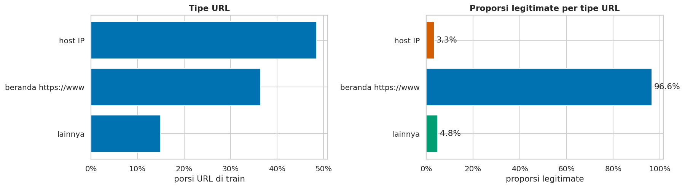
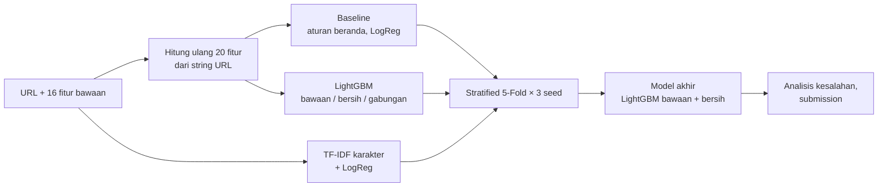
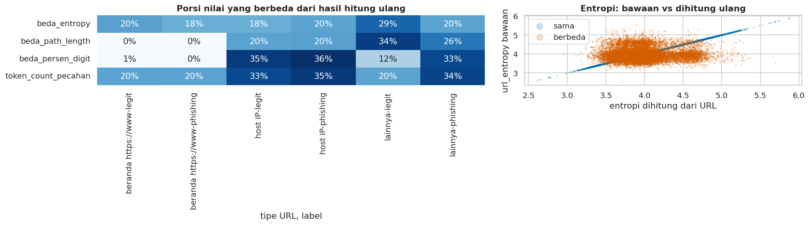
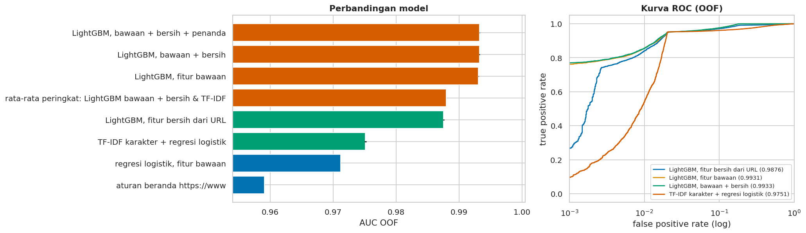
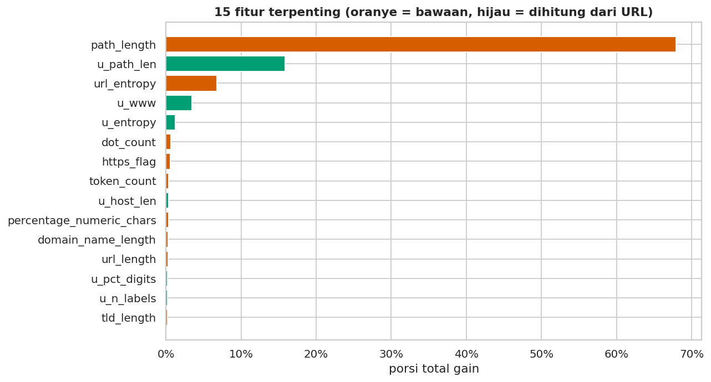
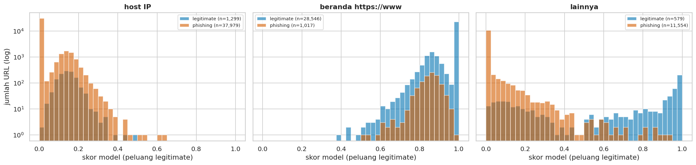

<p align="center">
  
  <br><sub>Gambar: halaman kompetisi <a href="https://www.kaggle.com/competitions/dsco">Data Science Olympiads Competition</a> di Kaggle.</sub>
</p>

# Mendeteksi URL Phishing: Apa yang Sebenarnya Dipelajari Model?
### Data Science Olympiads (DSCO) 2025 · Klasifikasi biner 80.974 URL

**AUC di atas 0,99 mudah dicapai di kompetisi ini. Apakah itu berarti model memahami phishing, atau hanya mengenali cara
dataset ini disusun?**

Kompetisi ini meminta model untuk membedakan URL legitimate dan phishing dari string URL dan 16 fitur leksikal (panjang,
entropi, jumlah titik, panjang path, persen digit, dan lainnya). Analisis disusun seperti laporan riset: setiap keputusan
pemodelan berasal dari temuan EDA, dan setiap temuan dibuktikan dengan grafik.

**Temuan utama: dua tipe URL menentukan hampir semua label. Beranda `https://www.<domain>` 96,6% legitimate dan host
berupa alamat IP 96,7% phishing, sehingga aturan satu baris sudah memberi AUC 0,959. LightGBM mencapai 0,9933, dan 92%
kesalahannya ada di URL yang labelnya berlawanan dengan isi URL-nya.**



---

## Ruang lingkup

- Eksplorasi tipe URL, fitur bawaan per kelas, kecocokan fitur bawaan dengan string URL, label yang berlawanan dengan
  tipe URL, dan kesamaan distribusi train dan test (adversarial validation).
- Baseline aturan dan regresi logistik, LightGBM pada empat set fitur, dan model teks TF-IDF karakter.
- Kepentingan fitur dan analisis kesalahan per tipe URL.

Notebook asli dari masa kompetisi (Desember 2025) hilang. Seluruh analisis di repositori ini disusun ulang dari nol pada
November 2026 dan dijalankan penuh di Kaggle.

## Data dan desain eksperimen

| Data | Isi | Baris |
| --- | --- | ---: |
| `train.csv` | URL, 16 fitur leksikal, dan label `ClassLabel` (1 = legitimate) | 80.974 |
| `test.csv` | URL yang diprediksi | 20.244 |

Metrik kompetisi adalah ROC AUC. Validasi memakai Stratified 5-Fold yang diulang dengan 3 seed; adversarial AUC train vs
test 0,498.



## Cerita dari data

### 1. Sebagian fitur bawaan tidak cocok dengan URL-nya



Panjang URL, jumlah digit, dan jumlah titik cocok 100% dengan string URL, tetapi entropi, panjang path, persen digit, dan
jumlah token berbeda di 14–29% baris. Secara total 56% baris punya minimal satu nilai yang diubah, di train maupun test.
Porsinya hampir sama untuk kedua label di dalam tipe URL yang sama, jadi ini noise yang disisipkan penyusun data.

### 2. Sekitar 3% label berlawanan dengan isi URL

1.299 URL host IP berlabel legitimate, misalnya `http://59.89.186.229:59571/bin.sh`, dan 1.017 beranda biasa berlabel
phishing. Menariknya, di dalam host IP, entropi bawaan memisahkan label dengan AUC 0,90, sedangkan entropi yang dihitung
dari URL hanya 0,83. Noise yang disisipkan ikut membawa jejak label.

## Hasil

### Perbandingan model (AUC OOF, Stratified 5-Fold × 3 seed)



| Model | AUC OOF | Std antar seed |
| --- | ---: | ---: |
| Aturan: beranda `https://www` = legitimate | 0,95908 | 0 |
| Regresi logistik, fitur bawaan | 0,97120 | 0,00002 |
| TF-IDF karakter + regresi logistik | 0,97513 | 0,00016 |
| LightGBM, fitur bersih dari URL | 0,98755 | 0,00009 |
| LightGBM, fitur bawaan | 0,99309 | 0,00004 |
| **LightGBM, bawaan + bersih (akhir)** | **0,99326** | 0,00005 |
| LightGBM, bawaan + bersih + penanda perbedaan | 0,99327 | 0,00005 |

Model yang hanya memakai fitur bersih dari URL 0,006 lebih rendah dari model dengan fitur bawaan. Selisih itu adalah
informasi yang dibawa fitur yang sudah diubah. Model akhir dipilih dengan aturan parsimoni: penanda perbedaan hanya
menambah 0,00001.

### Skor kompetisi

| Submission | Public | Private |
| --- | ---: | ---: |
| Notebook ini (late submission, tidak masuk leaderboard resmi) | 0,99399 | 0,99390 |
| Submission tim dengan private tertinggi, Desember 2025 (peringkat akhir 24 dari 90) | 0,99364 | 0,99378 |
| Peringkat 1 leaderboard private | | 0,99410 |

Papan atas sangat rapat: selisih peringkat 1 dan peringkat 24 hanya sekitar 0,0003, lebih kecil dari pengaruh satu
kelompok label yang keliru.

## Interpretasi

### Model bertanya "apakah URL ini punya path?"



Panjang path (bawaan 68% gain, versi bersih 16%) mendominasi, disusul entropi dan penanda `www`. Itu sama dengan
membedakan beranda dari URL lain.

### Di mana model salah



Semua host IP berlabel legitimate dan semua beranda berlabel phishing diprediksi salah, dan keduanya memuat 92% seluruh
kesalahan. Model memberi skor sesuai bentuk URL-nya, dan menurut kami labelnya yang keliru. Kelemahan nyata model ada pada
URL legitimate yang bukan beranda, seperti `support.google.com/chrome/answer/...` (28,8% salah): karena hampir semua URL
legitimate di data latih adalah beranda, model belajar bahwa URL dengan path itu mencurigakan.

## Menjalankan

Notebook dijalankan di Kaggle (CPU, sekitar 10 menit).

```bash
pip install -r requirements.txt kaggle
python _build_notebook.py                  # regenerasi notebook + runner dari satu sumber
kaggle kernels push -p kaggle-notebook     # notebook yang tampil di Kaggle
kaggle kernels push -p kaggle              # runner: mengeksekusi notebook dan menyimpan versi ber-output
kaggle kernels output fauzan2/dsco-2025-phishing-url-runner -p output/
```

Data kompetisi tidak disertakan di repositori. Unduh dari halaman kompetisi ke `data/raw/` (berisi `train.csv`,
`test.csv`, `sample_submission.csv`), lalu jalankan notebook dari folder `notebooks/`.

## Peta repositori

| Lokasi | Isi |
| --- | --- |
| `notebooks/dsco-2025-phishing-url.ipynb` | Notebook riset lengkap dengan output |
| `src/data/load_data.py` | Pencarian path data dan load |
| `src/features/url_features.py` | Tipe URL, 20 fitur yang dihitung ulang dari URL, dan penanda perbedaan |
| `src/models/train_model.py` | Stratified K-Fold berulang, LightGBM, regresi logistik, TF-IDF |
| `src/visualization/plots.py` | Gaya grafik dan palet ramah buta warna (Okabe–Ito) |
| `reports/figures/` | 6 grafik yang dipakai di notebook dan README |
| `reports/*.csv` | Hasil CV dan kesalahan per tipe URL |
| `submissions/submission.csv` | Submission akhir (probabilitas) |
| `_build_notebook.py`, `_findings.json` | Sumber tunggal notebook dan runner Kaggle, beserta teks temuan |
| `kaggle-notebook/`, `kaggle/` | Metadata kernel notebook dan runner |

## Keterbatasan

Kelas legitimate hampir seluruhnya beranda, sehingga model tidak belajar membedakan halaman dalam situs yang sah dari
halaman phishing; pada URL dunia nyata yang lebih beragam, skornya akan jauh lebih rendah. Sebagian label tampak keliru,
dan sebagian fitur disisipi noise yang membawa jejak label, sehingga skor kompetisi tidak mencerminkan kemampuan deteksi
phishing yang sebenarnya. Skor late submission diperoleh setelah kompetisi berakhir dan tidak dapat dibandingkan secara
setara dengan peserta yang bekerja dalam batas waktu kompetisi.

## Penulis

**Fauzan Ahsanudin Alfikri** · [Kaggle: fauzan2](https://www.kaggle.com/fauzan2)

Data berasal dari kompetisi [Data Science Olympiads Competition](https://www.kaggle.com/competitions/dsco) (Data Science
Club) dan hanya digunakan untuk keperluan edukasi dan portofolio.
